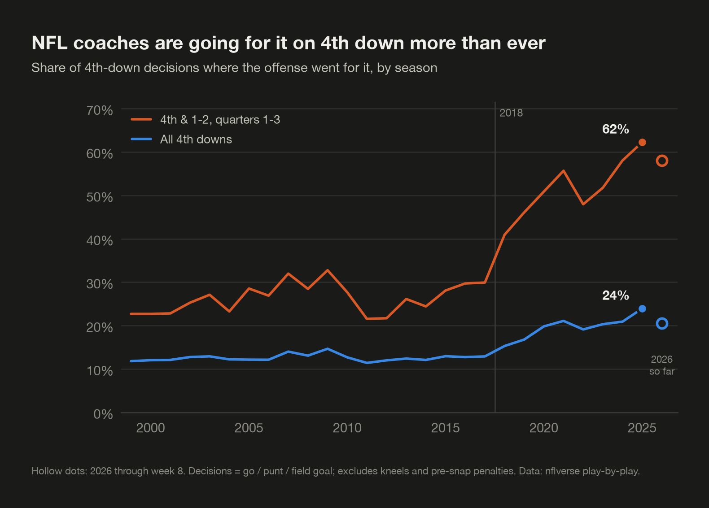
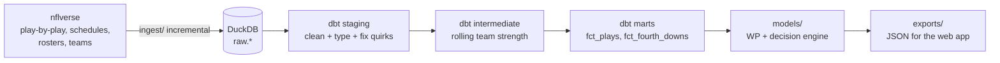
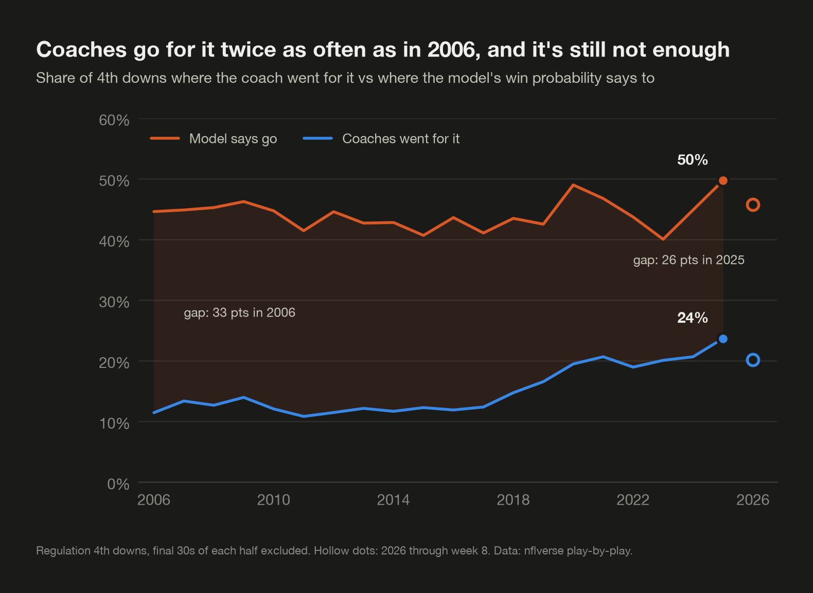

# NFL Analytics: 4th-Down Decision Grades

Grading every NFL coach's 4th-down decisions with win-probability models ("how many wins are
coaches giving away by playing it safe?"), plus broader ML findings from the same play-by-play data.



| Phase | What | Status |
|---|---|---|
| 1 | Data pipeline: nflverse → DuckDB → dbt marts, tests, weekly refresh | done |
| 2 | Win-probability, conversion, FG and punt models + decision engine + exports | done |
| 3 | Next.js site: 4th-down calculator, "You Make the Call", WP charts, leaderboard | planned |

## Quickstart

Requires [uv](https://docs.astral.sh/uv/). Everything else (Python 3.12, dbt, DuckDB) is installed by it.
On macOS, XGBoost also needs the OpenMP runtime: `brew install libomp`.

```bash
make setup     # Python deps + dbt packages
make ingest    # nflverse -> data/nfl.duckdb (first run backfills 1999-present, ~2-3 min)
make dbt       # staging -> intermediate -> marts -> features, with data tests
make train     # train + evaluate the 4 models -> models/artifacts, models/reports (~40 s)
make score     # decision engine with the saved models, then dbt's scored models (~5 s)
make findings  # go-rate trend, famous 4th downs, coach leaderboard -> models/reports
make export    # JSON for the web app -> exports/
make check     # Phase 1 sanity checks
make test      # pytest (ingest logic, feature parity, model + engine behaviour)
```

`make refresh` runs ingest → dbt → score → export → check in about 30 seconds. It never retrains.
That's what the GitHub Action runs every Tuesday morning.

## How it fits together



- **ELT, not ETL.** `raw.*` is an untouched copy of nflverse (all ~372 play-by-play columns).
  All cleaning and feature engineering happens in SQL inside dbt, where it's versioned and tested.
- **Incremental ingest, full-rebuild dbt.** The schedule says which games are final. The ingest
  diffs that against what's already loaded and downloads only seasons with new games (a no-op
  weekly run takes ~1 s). dbt then rebuilds the marts from scratch. DuckDB does 1.3M plays in
  seconds, and rolling-window features stay correct without incremental bookkeeping.
- **One file is the warehouse.** `data/nfl.duckdb` (gitignored). In CI it's cached between runs; a
  cache miss just triggers a full backfill.

## Data model

| Model | Grain | What it's for |
|---|---|---|
| `staging.stg_pbp` | 1 row per real play | Clean names and types; admin rows (timeouts, quarter ends) removed |
| `staging.stg_schedules` | 1 row per game | Final score, closing spread/total, head coaches, roof/surface/weather |
| `staging.stg_rosters`, `stg_teams` | player-team-season / team | Later features, team colors and logos |
| `intermediate.int_team_game_epa` | 1 row per team-game | Offensive and defensive EPA totals |
| `intermediate.int_team_strength` | 1 row per team-game | **Pre-game** rolling EPA/play (last 8 games + season-to-date) |
| `marts.fct_plays` | 1 row per play | Pre-snap game state + team strength + play result + game outcome |
| `marts.fct_fourth_downs` | 1 row per 4th-down decision | go / punt / field_goal, situation, and what happened |
| `features.feat_*` | 1 row per model example | Phase 2 feature tables + data-driven engine lookups |
| `marts.fct_fourth_down_decisions` | 1 row per regulation decision | WP of each option, recommendation, `wp_lost` (built after scoring) |

`fct_plays` columns come in four groups, in order: **game state** (known before the snap),
**team strength** (known before kickoff), **play result** (post-snap, never a feature), and
**game outcome** (the WP label, never a feature).

## Leakage guards

No feature may use information from after the moment it describes. Enforced by tests, not by convention:

| Risk | Guard |
|---|---|
| nflverse `total_home_score` is the score **after** the play (true on 100% of TD plays) | Features use pre-snap scores; `assert_scores_chain_pre_to_post` checks each play's pre-snap score equals the previous play's post-play score |
| A timeout called right after a snap is already subtracted on that snap's row | Pre-snap timeouts come from the previous event; `assert_pre_snap_timeouts_exclude_later_timeouts` |
| Rolling team stats including the current or future games | Every window ends at `1 preceding`; `assert_team_strength_uses_only_prior_games` |
| Shuffling plays across seasons in model validation | Phase 2 splits strictly by season |

One caveat that can't be tested away: nflverse's EPA and WP values come from models fit on all
seasons. We treat EPA as a fixed measurement scale (standard practice), and we flag that nflverse's
WP has seen our test season when we benchmark against it.

## nflverse quirks found and handled

Each one was verified against the raw data before writing the fix (details in `dbt/models/staging/stg_pbp.sql`):

1. `play_id` isn't chronological (timeout rows get out-of-order ids). Plays are ordered by `order_sequence`.
2. Pre-snap timeout counts can include a timeout called after the snap (above).
3. ~400 real 1999 plays with penalties have `play_type = NULL`; their type is inferred from nflverse's flags instead of dropping them.
4. Some 1999-2002 rows use `''` instead of NULL for `posteam` and `play_type`.
5. Play-by-play uses **current** team abbreviations for every season (LV in 2015) while schedules
   use historical ones (OAK). Schedules are normalized so team joins can't silently drop relocated teams.
6. nflverse's `home_opening_kickoff` contradicts the play text in ~2% of games, so the
   2nd-half-kickoff feature is derived from the first possession instead.
7. Placeholder rows (`*** play under review ***`) and stat-note comments mislabeled as passes are dropped.
8. Three final games (1999 BAL-STL, 2000 SD-KC, 2000 BUF-MIA) have no play-by-play upstream. The ingest
   records them so it doesn't re-download those seasons every week.

**4th-down decisions** need a snap. Pre-snap penalties (the replayed down is its own decision) and
kneels are excluded. Punts and FGs wiped out by a penalty still count as kicks, and fakes count as
"go". All 114,802 4th-down plays since 1999 are accounted for: 111,253 decisions + 3,465 pre-snap
penalties + 84 kneels/spikes.

## Sanity check (Phase 1)

- Every completed season's game count matches the league format (e.g. 284 in 2022, when BUF@CIN was cancelled).
- Go-for-it rate: **12.6%** in 1999-2017, **19.7%** in 2018-2025, peaking at **23.9%** in 2025.
  On 4th & 1-2 in quarters 1-3, the rate rose from ~25% to **62%**.
- Clean go attempts convert **50.9%** of the time; field goals are made **83.6%** of the time.

## Phase 2: models and the decision engine



**Findings (regulation 4th downs, 2006-2025):**
- Coaches went for it on **11.4%** of 4th downs in 2006 and **23.7%** in 2025. The model says go on ~41-50% every year.
- On "clear go" spots, where going is worth at least 1 point of win probability, coaches went for it
  **24%** of the time in 2006 and **50%** in 2025.
- Almost all of the win probability lost comes from conservatism: kicking when the model says go
  costs about **0.5 wins per team per season**, while going when it says kick costs about 0.02.
- [Ten famous 4th downs, graded](models/reports/famous_fourth_downs.md): the model agrees with the coach
  on 7, including Belichick's 2009 4th & 2 (+1.5 pts). It disagrees with LaFleur's 2020 NFC title game FG (-5.0 pts).
- [2025 coach leaderboard](models/reports/coach_leaderboard_2025.png): wins lost range from 0.24 (Pete Carroll)
  to 0.99 (Raheem Morris).

### The models

All four use the same season-based split: **train 2006-2022, validate 2023, test 2024**. Plays are
never shuffled across seasons. The models that grade 2025 and 2026 decisions have never seen those
seasons, or 2023-2024.

| Model | Method | Held-out 2024 result |
|---|---|---|
| Win probability | XGBoost, 13 pre-snap features incl. score diff / sqrt(sec + 1), monotone constraints | Brier **0.1389** vs nflverse `vegas_wp` 0.1364 (fit *with* 2024) and `wp` 0.1569; [calibration](models/reports/wp_calibration.png), [importance](models/reports/wp_feature_importance.png), [SHAP](models/reports/wp_shap_summary.png) |
| 4th-down conversion | shallow XGBoost (monotone) + Platt calibration on 2023 | Brier 0.2221 vs 0.2241 for a yards-to-go-only baseline; [calibration](models/reports/conversion_calibration.png) |
| Field goal | logistic regression (distance, distance^2, indoors, turf, wind, temp, distance x wind, era trend) | 84.2% made vs 84.9% predicted; [by distance](models/reports/fg_make_by_distance.png) |
| Punt | isotonic regression, recalibrated on 2023 | 7.25 yd mean error, +0.01 yd bias (naive: 8.74); [curve](models/reports/punt_outcome.png) |

Sanity states pass: an opening drive at even spread is 0.514, and up 21 with 2:00 left is 0.999. The WP
model is exported to ONNX (`models/artifacts/wp.onnx`) and verified against XGBoost to 3e-7. The input
contract for the browser calculator is in `models/artifacts/wp_onnx_contract.json`.

### The decision engine

For every regulation 4th down:

```
WP(go)   = p_convert * WP(1st down after the average conversion gain) + (1 - p_convert) * WP(turnover on downs)
WP(punt) = WP(opponent's ball where punts from this spot leave them)
WP(FG)   = p_make * WP(+3, then kick off) + (1 - p_make) * WP(opponent's ball at the spot of the kick)
```

When the opponent gets the ball, the state is flipped (score, spread, timeouts, home, 2nd-half kickoff)
and scored as 1 - their WP. The constants (conversion gains, clock used per outcome, kickoff starts by
season) come from dbt tables built from the data. The engine refuses to write scores unless five
consensus situations come out right. dbt's `fct_fourth_down_decisions` picks the best option and
computes `wp_lost`.

### Limitations, stated plainly

- **Overtime is not graded**: different rules and its own clock. Neither are the **final 30 seconds of
  a half** (3.8% of decisions), where the engine's average clock-runoff assumptions break down.
- **Fakes are graded as ordinary go attempts.** The model can't price surprise.
- **Era drift.** 2024 teams converted 57.5% of go attempts vs 54.7% predicted, so the engine is, if
  anything, *conservative* about going for it. Punting improvement was corrected (see the punt model).
- **Late, tied, in field-goal range**: both this model and nflverse's underrate the offense's chances
  in the final minute (~80% predicted vs ~95% actual, small samples).
- **Grades for 2006-2022 are in-sample for the WP model.** It's regularized, but the cleanest
  numbers are 2023 onward.

### Exports for the web app

`make export` writes `exports/`: `meta.json`, `leaderboard/{season}.json`,
`worst_decisions/{season}/week_NN.json` (+ `latest.json`), and `games/{season}/{game_id}.json`
(columnar home-team WP series + key plays + 4th-down grades), for 2025 and 2026 to date.

### Benchmark against nfl4th

`make benchmark` compares every 2023-2025 call with Ben Baldwin's nfl4th and attributes the gap
component by component: `models/reports/nfl4th_benchmark.md`. This engine says go a bit more
often (46% vs 40%), driven by its conversion model, which real 2023-2025 conversion rates support.

## Phase 3a: the 4th-down calculator (`web/`)

Next.js + TypeScript, fully client-side: win probability via `wp.onnx` in onnxruntime-web, and the
rest of the engine ported to TypeScript. `make export-web` writes the browser models and a parity
fixture; `cd web && npm test` checks the TS engine against the Python one on 600 real 4th downs
(max difference 2.4e-7). See `web/README.md`.

## Repo layout

```
ingest/      Python: nflverse -> DuckDB raw tables (incremental)
dbt/         dbt-duckdb project: staging / intermediate / marts + tests
analysis/    sanity check + shared dark chart theme
models/      Phase 2: WP, conversion, FG, punt models, decision engine, findings, exports
  artifacts/   saved models (joblib, wp.onnx) + punt lookup + ONNX input contract
  reports/     evaluation plots (dark theme) + metrics JSON + findings
exports/     precomputed JSON for the web app
web/         Phase 3: Next.js site (4th-down calculator)
tests/       pytest (ingest logic, no network)
```

Data: [nflverse](https://github.com/nflverse) (nflfastR play-by-play), loaded via
[nflreadpy](https://github.com/nflverse/nflreadpy).
