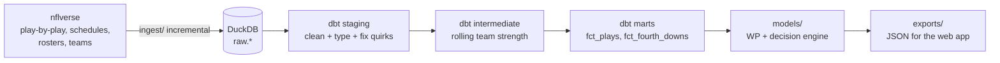

# NFL Analytics: 4th-Down Decision Grades

Grading every NFL coach's 4th-down decisions with win-probability models ("how many wins are
coaches giving away by playing it safe?"), plus broader ML findings from the same play-by-play data.


| Phase | What | Status |
|---|---|---|
| 1 | Data pipeline: nflverse → DuckDB → dbt marts, tests, weekly refresh | done |
| 2 | Win-probability, conversion, FG and punt models + decision engine | in progress |
| 3 | Next.js site: 4th-down calculator, "You Make the Call", WP charts, leaderboard | planned |

## Quickstart

Requires [uv](https://docs.astral.sh/uv/). Everything else (Python 3.12, dbt, DuckDB) is installed by it.

```bash
make setup     # Python deps + dbt packages
make ingest    # nflverse -> data/nfl.duckdb (first run backfills 1999-present, ~2-3 min)
make dbt       # build staging -> intermediate -> marts and run 71 data tests
make check     # sanity checks + analysis/output/go_rate_by_season.png
make test      # Python unit tests (no network)
```

`make refresh` runs ingest → dbt → check. That's what the GitHub Action runs every Tuesday morning.

## How it fits together



- **ELT, not ETL.** `raw.*` is an untouched copy of nflverse (all ~372 play-by-play columns).
  All cleaning and feature engineering happens in SQL inside dbt, where it's versioned and tested.
- **Incremental ingest, full-rebuild dbt.** The schedule says which games are final. The ingest
  diffs that against what's already loaded and downloads only seasons with new games (a no-op
  weekly run takes ~1 s). dbt then rebuilds the marts from scratch. DuckDB does 1.3M plays in
  seconds, and rolling-window features stay correct without incremental bookkeeping.
- **One file is the warehouse.** `data/nfl.duckdb` (gitignored). In CI it's cached between runs; a
  cache miss just triggers a full backfill.

## Data model

| Model | Grain | What it's for |
|---|---|---|
| `staging.stg_pbp` | 1 row per real play | Clean names and types; admin rows (timeouts, quarter ends) removed |
| `staging.stg_schedules` | 1 row per game | Final score, closing spread/total, head coaches, roof/surface/weather |
| `staging.stg_rosters`, `stg_teams` | player-team-season / team | Later features, team colors and logos |
| `intermediate.int_team_game_epa` | 1 row per team-game | Offensive and defensive EPA totals |
| `intermediate.int_team_strength` | 1 row per team-game | **Pre-game** rolling EPA/play (last 8 games + season-to-date) |
| `marts.fct_plays` | 1 row per play | Pre-snap game state + team strength + play result + game outcome |
| `marts.fct_fourth_downs` | 1 row per 4th-down decision | go / punt / field_goal, situation, and what happened |

`fct_plays` columns come in four groups, in order: **game state** (known before the snap),
**team strength** (known before kickoff), **play result** (post-snap, never a feature), and
**game outcome** (the WP label, never a feature).

## Leakage guards

No feature may use information from after the moment it describes. Enforced by tests, not by convention:

| Risk | Guard |
|---|---|
| nflverse `total_home_score` is the score **after** the play (true on 100% of TD plays) | Features use pre-snap scores; `assert_scores_chain_pre_to_post` checks each play's pre-snap score equals the previous play's post-play score |
| A timeout called right after a snap is already subtracted on that snap's row | Pre-snap timeouts come from the previous event; `assert_pre_snap_timeouts_exclude_later_timeouts` |
| Rolling team stats including the current or future games | Every window ends at `1 preceding`; `assert_team_strength_uses_only_prior_games` |
| Shuffling plays across seasons in model validation | Phase 2 splits strictly by season |

One caveat that can't be tested away: nflverse's EPA and WP values come from models fit on all
seasons. We treat EPA as a fixed measurement scale (standard practice), and we flag that nflverse's
WP has seen our test season when we benchmark against it.

## nflverse quirks found and handled

Each one was verified against the raw data before writing the fix (details in `dbt/models/staging/stg_pbp.sql`):

1. `play_id` isn't chronological (timeout rows get out-of-order ids). Plays are ordered by `order_sequence`.
2. Pre-snap timeout counts can include a timeout called after the snap (above).
3. ~400 real 1999 plays with penalties have `play_type = NULL`; their type is inferred from nflverse's flags instead of dropping them.
4. Some 1999-2002 rows use `''` instead of NULL for `posteam` and `play_type`.
5. Play-by-play uses **current** team abbreviations for every season (LV in 2015) while schedules
   use historical ones (OAK). Schedules are normalized so team joins can't silently drop relocated teams.
6. nflverse's `home_opening_kickoff` contradicts the play text in ~2% of games, so the
   2nd-half-kickoff feature is derived from the first possession instead.
7. Placeholder rows (`*** play under review ***`) and stat-note comments mislabeled as passes are dropped.
8. Three final games (1999 BAL-STL, 2000 SD-KC, 2000 BUF-MIA) have no play-by-play upstream. The ingest
   records them so it doesn't re-download those seasons every week.

**4th-down decisions** need a snap. Pre-snap penalties (the replayed down is its own decision) and
kneels are excluded. Punts and FGs wiped out by a penalty still count as kicks, and fakes count as
"go". All 114,802 4th-down plays since 1999 are accounted for: 111,253 decisions + 3,465 pre-snap
penalties + 84 kneels/spikes.

## Sanity check (Phase 1)

- Every completed season's game count matches the league format (e.g. 284 in 2022, when BUF@CIN was cancelled).
- Go-for-it rate: **12.6%** in 1999-2017, **19.7%** in 2018-2025, peaking at **23.9%** in 2025.
  On 4th & 1-2 in quarters 1-3, the rate rose from ~25% to **62%**.
- Clean go attempts convert **50.9%** of the time; field goals are made **83.6%** of the time.

## Repo layout

```
ingest/      Python: nflverse -> DuckDB raw tables (incremental)
dbt/         dbt-duckdb project: staging / intermediate / marts + tests
analysis/    sanity check + shared dark chart theme
models/      Phase 2: WP, conversion, FG, punt models + decision engine
exports/     precomputed JSON for the web app
web/         Phase 3: Next.js site
tests/       pytest (ingest logic, no network)
```

Data: [nflverse](https://github.com/nflverse) (nflfastR play-by-play), loaded via
[nflreadpy](https://github.com/nflverse/nflreadpy).
