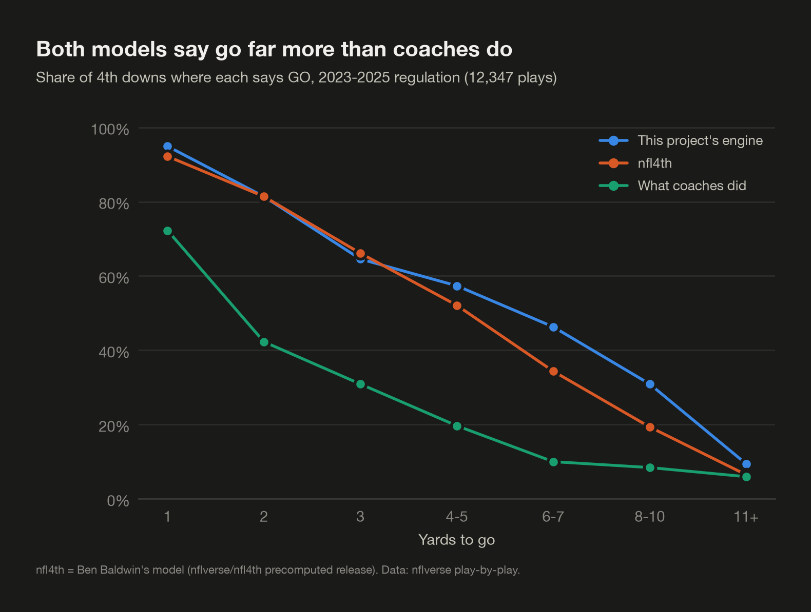

# Benchmark: this engine vs nfl4th

Regulation 4th downs, 2023-2025: 12,347 plays matched to nfl4th by game and play id
(85 of ours had no nfl4th row). nfl4th numbers come from its precomputed release file
(downloaded 2026-11-04); its component tables are pinned to commit `2ac170b`.
Reproduce with `uv run python -m models.nfl4th_benchmark`.

## Summary

- **The high go rate is mostly shared with nfl4th.** nfl4th says go on 40.1% of these 4th downs, this engine on 45.7%, coaches went for it on 21.5%. Both models say teams should go about twice as often as they do. The gap between the models is 5.6 points, and the two make the same call on 80.3% of plays.
- **Yes, this engine is systematically more aggressive, and the conversion model is why.** Swapping in nfl4th's P(first down) alone takes the go rate from 45.7% to 41.8%. Swapping every other component (FG, punt, clock, kickoff) moves it by 0.8 points or less each. With every swap, the go rate is 40.5%, within 0.4 points of nfl4th's.
- **Real outcomes back our conversion odds, not nfl4th's lower ones.** On every real go attempt, our model's average prediction is within 2.8 points of the actual rate in each season; nfl4th's is 2.1-5.5 points low. At 4-10 yards to go, where most of the gap lives, teams converted 43.1% (2024) and 42.9% (2025); we predicted 39.7% and 40.6%, nfl4th 38.2% and 38.9%. Brier scores on 2024-2025 attempts are a tie (0.2258 vs 0.2259).
- **Decision: document, don't change the conversion model.** The caveat that remains: both models only see attempts teams chose. Ours is trained on 4th-down attempts only; nfl4th also learns from 3rd downs, where nearly everyone goes for it, which may explain why it is more conservative. Outcomes can't settle how plays that were never attempted would have gone.
- **The gap grows by season** (41.2% vs 39.3% in 2023, 50.5% vs 41.8% in 2025). Our conversion model uses each team's recent offensive and defensive EPA, which rose in 2024-2025 along with real conversion rates; nfl4th's sees team quality only through the point spread and total.
- **Most disagreements are coin flips.** In 53% of plays where one model says go and the other doesn't, both models put the gap under 1 WP point. Counting only clear calls (go is better by 1+ point), the go rates are 25.0% (ours) vs 20.9% (nfl4th).
- **The benchmark found three real bugs**, fixed below (long FGs, kneel-downs, end of half). They weren't the cause of the gap, but each produced recommendations that were plainly wrong in late-game situations.

## Go rate and agreement

|  | Plays | Ours: go | nfl4th: go | Coaches went | Same call |
|---|---|---|---|---|---|
| All | 12,347 | 45.7% | 40.1% | 21.5% | 80.3% |

Recommendations side by side (rows = ours, columns = nfl4th):

| recommendation   |   FG |   Go |   Punt |
|:-----------------|-----:|-----:|-------:|
| FG               | 1987 |  292 |     59 |
| Go               |  721 | 4149 |    768 |
| Punt             |   77 |  511 |   3783 |

### By yards to go

| Yards to go | Plays | Ours: go | nfl4th: go | Coaches went | Same call |
|---|---|---|---|---|---|
| 1 | 1,439 | 94.9% | 92.2% | 72.3% | 89.8% |
| 2 | 946 | 81.4% | 81.4% | 42.3% | 77.7% |
| 3 | 951 | 64.6% | 66.1% | 30.9% | 73.7% |
| 4-5 | 1,900 | 57.4% | 52.1% | 19.7% | 71.1% |
| 6-7 | 1,717 | 46.3% | 34.4% | 10.0% | 72.4% |
| 8-10 | 2,299 | 30.9% | 19.4% | 8.4% | 77.7% |
| 11+ | 3,095 | 9.4% | 6.5% | 6.0% | 90.8% |

### By field position

| Line of scrimmage | Plays | Ours: go | nfl4th: go | Coaches went | Same call |
|---|---|---|---|---|---|
| Opp 1-10 | 1,029 | 61.2% | 59.9% | 41.0% | 74.5% |
| Opp 11-20 | 1,123 | 44.0% | 29.9% | 21.5% | 75.7% |
| Opp 21-30 | 1,160 | 41.0% | 34.8% | 25.7% | 78.6% |
| Opp 31-40 | 1,309 | 49.3% | 42.2% | 36.1% | 74.7% |
| Opp 41-49 + 50 | 1,392 | 65.9% | 57.0% | 34.1% | 79.2% |
| Own 40-49 | 1,676 | 57.6% | 49.0% | 21.1% | 80.6% |
| Own 30-39 | 2,097 | 40.6% | 39.0% | 12.7% | 82.3% |
| Own 20-29 | 1,572 | 25.8% | 23.9% | 5.9% | 88.6% |
| Own 1-19 | 989 | 25.6% | 24.0% | 3.9% | 84.8% |

### By score

| Offense is | Plays | Ours: go | nfl4th: go | Coaches went | Same call |
|---|---|---|---|---|---|
| Down 9+ | 2,439 | 61.9% | 58.1% | 40.5% | 76.8% |
| Down 4-8 | 2,093 | 56.3% | 52.2% | 26.8% | 83.1% |
| Down 1-3 | 1,216 | 45.7% | 38.2% | 18.8% | 85.0% |
| Tied | 2,291 | 39.1% | 37.4% | 13.6% | 83.4% |
| Up 1-3 | 972 | 38.1% | 27.7% | 13.0% | 81.1% |
| Up 4-8 | 1,654 | 34.2% | 27.3% | 12.9% | 81.7% |
| Up 9+ | 1,682 | 33.5% | 23.8% | 13.6% | 72.7% |

## Where the gap comes from

Method: keep this project's WP model and swap in nfl4th's version of one component at a time.
"+ X" = only X swapped. "all but X" = every swap except X, so the drop from "all swaps" to "all but X" is
what X contributes once everything else matches nfl4th. With no swaps, the code reproduces the stored
engine output to 0.0e+00.

- `conversion_prob`: nfl4th's P(first down) in place of our conversion model
- `conversion_yards`: nfl4th's full yards-gained distribution (where a conversion or a failure leaves the ball)
- `field_goal`: nfl4th's FG make table in place of our logistic regression
- `punt`: nfl4th's punt outcome distribution (muffs, return TDs; no punting inside the opponent's 31)
- `clock`: nfl4th's flat 6-second runoff for every outcome instead of our median runoffs
- `kickoff`: nfl4th's kickoff start (own 25 before 2024, own 30 after) instead of the season average

| Our engine with... | Go rate | vs ours | Agrees w/ nfl4th | Go rate, 6-10 to go | Go rate, opp 11-30 |
|---|---|---|---|---|---|
| `ours` | 45.7% | +0.0 pts | 80.3% | 37.5% | 42.5% |
| `+ conversion_prob` | 41.8% | -3.9 pts | 82.5% | 29.7% | 38.2% |
| `+ conversion_yards` | 41.5% | -4.2 pts | 82.7% | 28.4% | 37.4% |
| `+ field_goal` | 44.9% | -0.8 pts | 80.4% | 36.3% | 42.8% |
| `+ punt` | 45.9% | +0.2 pts | 80.8% | 37.3% | 43.8% |
| `+ clock` | 45.9% | +0.3 pts | 80.5% | 37.8% | 42.9% |
| `+ kickoff` | 45.3% | -0.4 pts | 80.6% | 36.9% | 41.5% |
| `all swaps` | 40.5% | -5.2 pts | 84.1% | 26.3% | 38.5% |
| `all but conversion` | 45.0% | -0.7 pts | 81.1% | 35.6% | 43.4% |
| `all but field_goal` | 41.2% | -4.4 pts | 84.2% | 27.5% | 38.3% |
| `all but punt` | 40.4% | -5.3 pts | 83.2% | 27.0% | 37.1% |
| `all but clock` | 40.4% | -5.2 pts | 83.9% | 26.1% | 38.0% |
| `all but kickoff` | 40.9% | -4.8 pts | 84.0% | 26.9% | 39.7% |

What "all swaps" still doesn't change: the WP model (nfl4th averages its own model with nflfastR's),
and touchdowns (nfl4th: +6 then the better of the PAT and 2-pt try; ours: +7). The kneel-out and end-of-half
rules already match nfl4th's in both columns. The remaining gap between "all swaps" and nfl4th's own calls is
the WP model plus the touchdown detail: it barely moves the go rate but accounts for most of the remaining
16% of plays where the calls differ.

### Which conversion model fits real attempts better?

Every real go-for-it attempt in 2024-2025 (2024 is our test season, 2025 is unseen). Teams chose these
attempts, so this is a selected sample, but the same one for both models.
Brier: ours 0.2258, nfl4th 0.2259 (lower is better).

| Yards to go | Attempts | Converted | Ours predicted | nfl4th predicted |
|---|---|---|---|---|
| 1 | 685 | 69.1% | 72.2% | 67.1% |
| 2 | 253 | 61.7% | 58.0% | 54.0% |
| 3 | 201 | 53.2% | 47.1% | 48.4% |
| 4-5 | 229 | 54.1% | 45.3% | 44.2% |
| 6-7 | 101 | 33.7% | 39.5% | 37.6% |
| 8-10 | 119 | 29.4% | 30.9% | 28.7% |
| 11+ | 107 | 23.4% | 19.1% | 15.8% |
| All | 1,695 | 56.3% | 55.3% | 52.1% |

By season (2023 is the season our model's Platt step was calibrated on, so it isn't out of sample for ours):

| Season | Yards to go | Attempts | Converted | Ours predicted | nfl4th predicted |
|---|---|---|---|---|---|
| 2023 | All | 803 | 52.1% | 51.9% | 49.9% |
| 2024 | All | 787 | 57.6% | 54.8% | 52.0% |
| 2025 | All | 908 | 55.2% | 55.7% | 52.2% |
| 2023 | 4-10 | 233 | 37.3% | 37.6% | 37.5% |
| 2024 | 4-10 | 204 | 43.1% | 39.7% | 38.2% |
| 2025 | 4-10 | 245 | 42.9% | 40.6% | 38.9% |

### Which FG model fits real kicks better?

Every 4th-down field goal attempt in 2024-2025. Past ~55 yards both models sit below the actual rate on
purpose: these are kicks teams chose to try, made by kickers they trust, while the engine has to price
the kick for an average kicker (see "Fixes" below).

| Kick distance | Attempts | Made | Ours predicted | nfl4th predicted |
|---|---|---|---|---|
| <40 | 1,029 | 95.2% | 95.3% | 95.7% |
| 40-44 | 293 | 83.3% | 86.4% | 85.4% |
| 45-49 | 278 | 77.7% | 79.1% | 77.9% |
| 50-54 | 321 | 73.2% | 70.0% | 72.1% |
| 55-59 | 146 | 67.1% | 58.1% | 61.6% |
| 60+ | 20 | 55.0% | 35.6% | 42.3% |

## Fixes made because of this benchmark

The first run (engine at commit `9ae2c3a`) said go on 44.8% of these plays, agreed with nfl4th on 78.9%, and
its biggest disagreements exposed three engine bugs. None of them was the cause of the go-rate gap, but
each one produced recommendations that were plainly wrong:

1. **Long field goals were priced off elite kickers.** The FG model was fit on attempted kicks, and
   only teams that trust their kicker try a 60-yarder (since 2018, teams kick on 48% of 4th downs at 55
   yards but 5% at 60). Its 64-yard make probability was 42% and then fell off a cliff to 0% at 69. Now: the
   selection correction from nfl4th (blend toward the curve fit on distances everyone attempts,
   weighted by the attempt rate), tapering to 0% one yard past the longest make in the data
   (`models/field_goal.py`).
2. **No kneel-downs.** Down 1 with 0:40 left, punting from your own 30 to an opponent with no
   timeouts left: the WP model gave the punt 19%. In reality the opponent kneels and it's ~0%. A
   leader with a fresh set of downs and enough clock-killing kneels now wins (`kneel_out` in
   `models/decision_engine.py`, the same rule nfl4th uses).
3. **The half never ended.** Outcomes stopped the clock at 0:01, so a conversion with 3 seconds
   left in the half still had a snap to come, and the engine said go on 4th & 2 at the opponent's
   34 in that spot. An outcome that uses up the half now goes to the 2nd-half kickoff (or the
   final score in the 4th quarter) (`clock_expiry_wp`). These plays aren't graded (the final 30
   seconds of a half are excluded), but the calculator can reach them.

After the fixes the engine says go a little more often (the corrected FG odds and the kneel-out rule both
favor going), and agreement with nfl4th went up.

## The 20 biggest disagreements

Ranked by how sure both models are of opposite calls (our edge for our pick + nfl4th's edge for its pick).
WP is for the team with the ball. nfl4th has no punt option inside the opponent's 31 ("n/a").

| # | Game | Situation | Coach | Ours (go / punt / FG) | nfl4th (go / punt / FG) | Ours | nfl4th |
|---|---|---|---|---|---|---|---|
| 1 | 2025 wk 18 IND_HOU | Q4 02:42, down 2, 4th & 2 at HOU 4 (IND) | FG | 36% / 16% / 31% | 35% / n/a / 44% | **Go** | **FG** |
| 2 | 2024 wk 14 NYJ_MIA | Q2 00:52, down 2, 4th & 9 at MIA 12 (NYJ) | FG | 39% / 34% / 38% | 39% / n/a / 48% | **Go** | **FG** |
| 3 | 2024 wk 2 TB_DET | Q4 01:01, down 4, 4th & 8 at TB 11 (DET) | Go | 34% / 7% / 36% | 30% / n/a / 21% | **FG** | **Go** |
| 4 | 2024 wk 18 CHI_GB | Q4 00:58, down 2, 4th & 4 at CHI 37 (GB) | FG | 53% / 28% / 48% | 43% / 24% / 49% | **Go** | **FG** |
| 5 | 2024 wk 3 PHI_NO | Q2 00:14, down 3, 4th & 1 at NO 15 (PHI) | Go | 35% / 34% / 43% | 48% / n/a / 46% | **FG** | **Go** |
| 6 | 2025 wk 6 LAC_MIA | Q2 00:04, up 1, 4th & 2 at LAC 9 (MIA) | FG | 54% / 41% / 51% | 39% / n/a / 45% | **Go** | **FG** |
| 7 | 2025 wk 2 ATL_MIN | Q2 00:28, up 3, 4th & 6 at MIN 15 (ATL) | FG | 55% / 50% / 52% | 60% / n/a / 66% | **Go** | **FG** |
| 8 | 2025 wk 5 SF_LA | Q4 00:53, up 3, 4th & 8 at SF 3 (SF) | Punt | 55% / 52% / 22% | 56% / 62% / 38% | **Go** | **Punt** |
| 9 | 2023 wk 16 LV_KC | Q2 00:09, down 10, 4th & 5 at LV 18 (KC) | FG | 40% / 41% / 49% | 45% / n/a / 45% | **FG** | **Go** |
| 10 | 2024 wk 1 GB_PHI | Q1 04:44, up 3, 4th & 2 at PHI 5 (GB) | Go | 64% / 53% / 58% | 62% / n/a / 64% | **Go** | **FG** |
| 11 | 2025 wk 5 SF_LA | Q3 06:36, up 10, 4th & 2 at LA 2 (SF) | FG | 76% / 69% / 71% | 76% / n/a / 78% | **Go** | **FG** |
| 12 | 2024 wk 8 DAL_SF | Q2 02:59, up 4, 4th & 8 at SF 11 (DAL) | FG | 53% / 47% / 49% | 55% / n/a / 59% | **Go** | **FG** |
| 13 | 2023 wk 15 HOU_TEN | Q2 00:03, down 13, 4th & 1 at TEN 5 (HOU) | FG | 20% / 8% / 15% | 9% / n/a / 12% | **Go** | **FG** |
| 14 | 2023 wk 10 HOU_CIN | Q4 02:20, up 3, 4th & 3 at HOU 32 (HOU) | Punt | 74% / 68% / 39% | 69% / 70% / 47% | **Go** | **Punt** |
| 15 | 2025 wk 11 BAL_CLE | Q4 14:09, down 6, 4th & 5 at CLE 5 (BAL) | FG | 46% / 38% / 52% | 44% / n/a / 43% | **FG** | **Go** |
| 16 | 2025 wk 1 CIN_CLE | Q3 02:52, down 2, 4th & 4 at CLE 17 (CIN) | FG | 60% / 52% / 59% | 59% / n/a / 66% | **Go** | **FG** |
| 17 | 2023 wk 20 GB_SF | Q4 06:21, up 4, 4th & 9 at SF 23 (GB) | FG | 56% / 46% / 55% | 62% / n/a / 69% | **Go** | **FG** |
| 18 | 2024 wk 18 WAS_DAL | Q4 03:25, up 3, 4th & 6 at DAL 48 (DAL) | Punt | 57% / 52% / 37% | 60% / 63% / 45% | **Go** | **Punt** |
| 19 | 2023 wk 10 IND_NE | Q4 12:47, down 4, 4th & 5 at IND 5 (NE) | FG | 39% / 29% / 41% | 37% / n/a / 31% | **FG** | **Go** |
| 20 | 2023 wk 6 ARI_LA | Q2 00:46, up 3, 4th & 4 at LA 9 (ARI) | FG | 45% / 35% / 41% | 57% / n/a / 60% | **Go** | **FG** |
